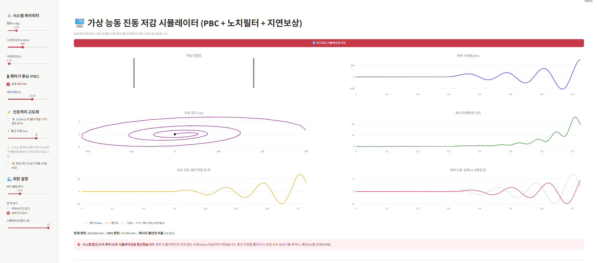
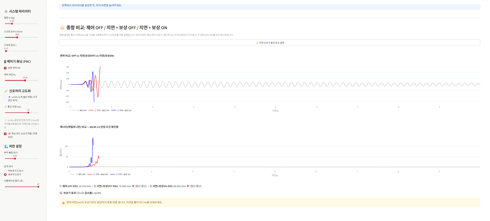
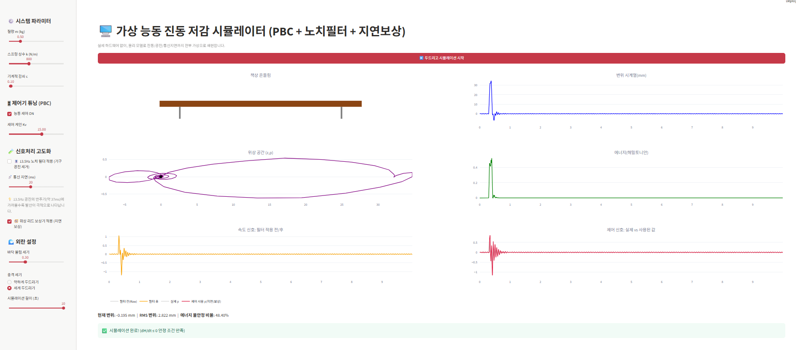
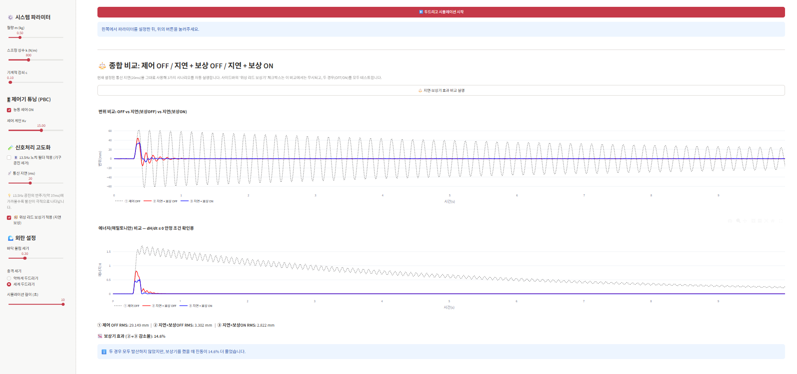
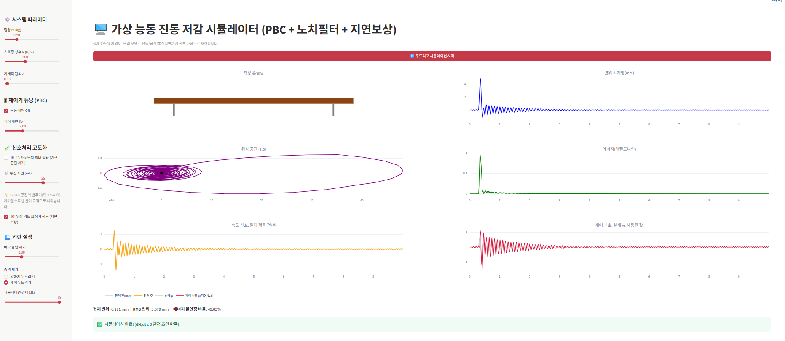
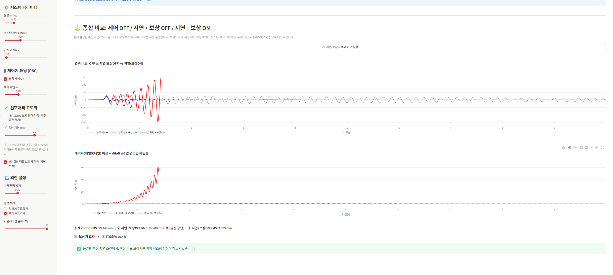
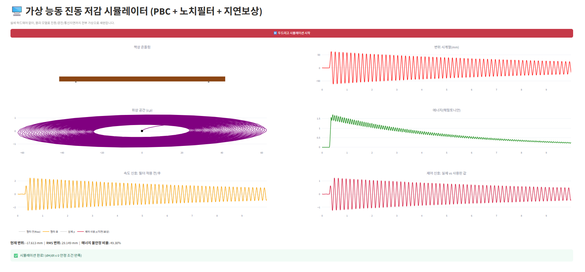
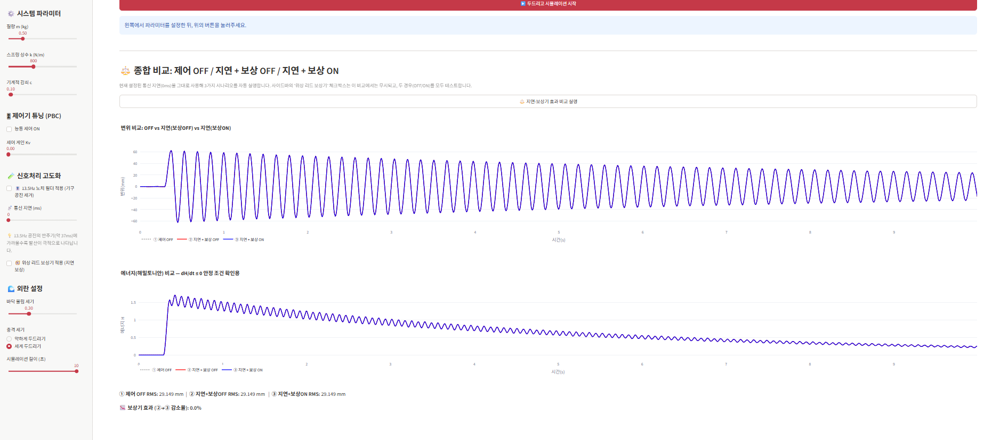

<div align="center">

# 🖥️ 가상 능동 진동 저감 시뮬레이터
### PBC(수동성 기반 제어) + 노치필터 + 지연보상

실제 하드웨어 없이, 물리 모델만으로 책상 진동 · 기구 공진 · 통신 지연까지 전부 가상으로 재현한  
**해밀토니안 수동성 제어(Passivity-Based Control) 기반 능동 진동 저감 시뮬레이터**입니다.

[](https://virtual-vibration-sim.streamlit.app)

</div>

---

## 🔗 라이브 데모

👉 **[여기를 클릭해서 바로 체험하기](https://virtual-vibration-sim.streamlit.app)**

---

## 📌 주요 기능

- 📦 책상 흔들림을 **질량-스프링-댐퍼** 모델로 시뮬레이션
- ⚡ **해밀토니안 에너지 셰이핑 기반 PBC(Passivity-Based Control)** 제어기
- 🎛️ 13.5Hz 기구 공진을 제거하는 **디지털 IIR 노치 필터**
- ⏱️ 통신 지연(Latency)을 보상하는 **위상 리드(Lead) 보상기**
- 🌀 (z, p) **위상 공간 궤적** 및 해밀토니안 에너지 실시간 시각화
- ⚖️ 제어 OFF / 지연+보상 OFF / 지연+보상 ON **3가지 시나리오 종합 비교**

---

## 🖼️ 스크린샷

<table>
<tr>
<td align="center"><b>지연 35ms - 발산</b><br></td>
<td align="center"><b>지연 35ms - 비교</b><br></td>
</tr>
<tr>
<td align="center"><b>지연 20ms - 안정</b><br></td>
<td align="center"><b>지연 20ms - 비교</b><br></td>
</tr>
<tr>
<td align="center"><b>Kv=8 안정</b><br></td>
<td align="center"><b>Kv=8 최적 비교</b><br></td>
</tr>
<tr>
<td align="center"><b>베이스라인 (제어 OFF)</b><br></td>
<td align="center"><b>베이스라인 (제어 OFF)</b><br></td>
</tr>
</table>

---

## 🧪 실험 결과 요약

| 시나리오 | 통신지연 | 제어게인(Kv) | 보상기 | RMS 변위 | 결과 |
|:---:|:---:|:---:|:---:|:---:|:---:|
| 베이스라인 | - | 제어 OFF | - | 높음 | ❌ 진동 지속 |
| 지연 35ms | 35ms | 15 | OFF | - | ⚠️ 발산 |
| 지연 35ms | 35ms | 15 | ON | - | ✅ 수렴 |
| 지연 20ms | 20ms | 15 | OFF | - | ✅ 안정 |
| Kv=8 최적 | 20ms | 8 | ON | 최소 | 🏆 베스트 |

---

## ⚙️ 설치 및 실행 방법

```bash
git clone https://github.com/suyeong0627/virtual-vibration-isolation-simulator.git
cd virtual-vibration-isolation-simulator
pip install -r requirements.txt
streamlit run app.py


🧠 기술 스택
Python · Streamlit · NumPy · SciPy · Matplotlib · Hamiltonian Mechanics

📄 라이선스
MIT License
